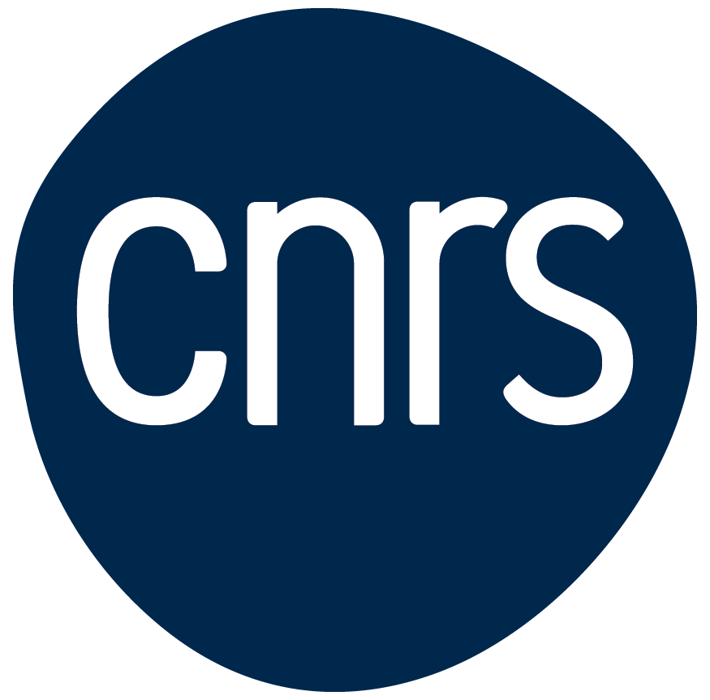
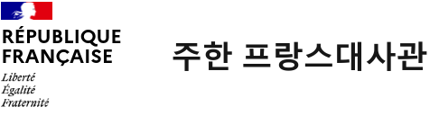

📅 Date: **Thursday 29 october 2026**, from 9am to 4pm

📍 Location: French Embassy, Seoul

✍️ Registration (free but mandatory and *before Oct 20*): [registration form](https://framaforms.org/french-korean-systems-biology-workshop-1st-edition-1781879123) (open).

### Scope and objectives

The workshop aims at making connections between the French and Korean scientific communities in mathematical and computational methods for systems biology, with applications to cancer research.

The program consists both in scientific talks related to mathematical and computational models in systems biology, with a focus on logical models for cancer research, as well as in presentations of international funding schemes to promote French-Korean scientific cooperation in this domain.

### Program

| Time | Session |
| --- | --- |
| 9:30-9:50 | **Opening Remarks**, with introduction of participants |
| 9:50-10:20 | **Plenary Talk I**   🇫🇷 **Dr. Loïc Paulevé** (CNRS/LaBRI, Bordeaux, France; coPI of ANR-NRF REPAIRNET project)  *Symbolic AI methods for systems biology* |
| 10:20-10:35 | ☕ *Coffee Break* |
| 10:35-12:05 | **Session 1 — Computational and Mathematical Models for Cancer Systems Biology**   *(15min talks + Q&A)*|
|   | 🇰🇷 **Dr. Dongkwan Shin** (National Cancer Center, South Korea; coPI of ANR-NRF REPAIRNET project)   *Targeting cell-state transitions across the colorectal cancer landscape* |
|   | 🇫🇷 **Dr. Élisabeth Rémy** (CNRS/I2M, Marseille, France)   *Mathematical modeling for systems biology, application to resistance in Leukemia* |
|   | 🇰🇷 **Dr. Jonghyun Lee** (Division of Cancer Data Science, National Cancer Center, South Korea)   *Expressed-variant subclones and transcriptional cell states in colorectal cancer and precancerous lesions* |
|   | 🇫🇷 **Dr. Emmanuel Barillot** (Institut Curie, Paris, France)   *AI and multimodal models of cancer* |
|   | 🇰🇷 **Mr. Hyunsoo Yeo** (Department of Bio and Brain Engineering, KAIST, South Korea)   *Quantifying influence propagation of input node for cell fate control of mutated biological networks* |
| 12:05-13:20  |   🍽️ Lunch     |
| 13:20-13:50 | **Plenary Talk II**   🇰🇷 **Prof. Kwang-Hyun Cho** (Department of Bio and Brain Engineering, KAIST, South Korea)  *Reversion of cancer and aging: A reverse control problem* |
| 13:50-14:45 | **Session 2 — Cell Fate Control and Transitions**  *(15min talks + Q&A)* |
|   | 🇫🇷 **Dr. Laurence Calzone** (Institut Curie, Paris, France)   *Logical and multiscale modeling for cancer* |
|   | 🇰🇷 **Prof. Jung-Min Yang** (School of Electronics Engineering, Kyungpook National University, South Korea)   *Robust open-loop control for biological systems with logical models* |
|   | 🇰🇷 **Mr. Corbin Hopper** (Department of Bio and Brain Engineering, KAIST, South Korea)   *Inferring irreversibility of cell fate transitions from transcriptomic data*
| 14:45-15:00 | ☕ *Coffee Break* |
| 15:00-16:00 | **Session 3 — Funding Schemes for International Research** |
|   | **French Embassy in South Korea**   *Actions for scientific cooperation* |
|   | **CNRS Office for Japan, South Korea & Taiwan** with Mr. Alban Belloir   *France – North-East Asia cooperation programs*
|   | **EURAXESS Korea** with Mr. Tomasz Wierzbowski   *European funding schemes*
|   | **Open Discussion**
| 16:00 | Closing remarks |

### Venue

⚠️ You will need to provide a formal identity document. **Registration is mandatory**.

**French embassy**
> 43-12 Seosomun-ro, Seodaemun-gu\
> Seoul\
> [Google Map](https://maps.app.goo.gl/C6d6wvSjKk4yjBpFA)\
> [Kakao Map](https://place.map.kakao.com/8509394)

### Organizing commitee

* [Dongkwan Shin](https://ncc-gcsp.ac.kr/n_academics/shindongkwan.jsp?flag=22) (NCC, Goyang, South Korea)
* [Loïc Paulevé](https://loicpauleve.name) (CNRS/LaBRI, Bordeaux, France)
* [Kwang-Hyun Cho](https://sbie.kaist.ac.kr/) (KAIST, Daejeon, South Korea)
* [Elisabeth Rémy](https://remy.perso.math.cnrs.fr/) (CNRS/I2M, Marseille, France)
* [Sébastien Codina](https://www.linkedin.com/in/sebastiencodina/?locale=fr) (French Embassy, Seoul, South Korea)

### Acknowledgment

&nbsp; &nbsp;&nbsp; &nbsp;&nbsp; &nbsp;

